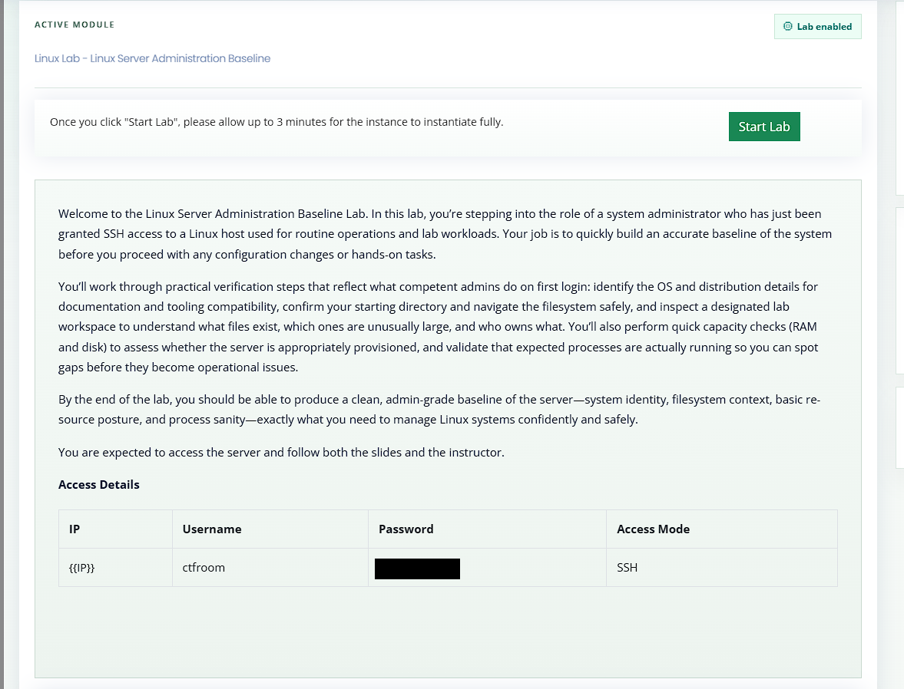
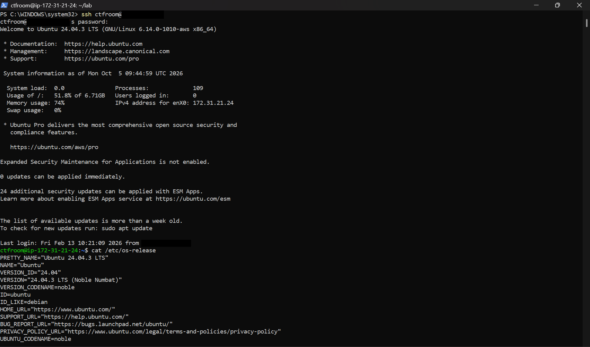
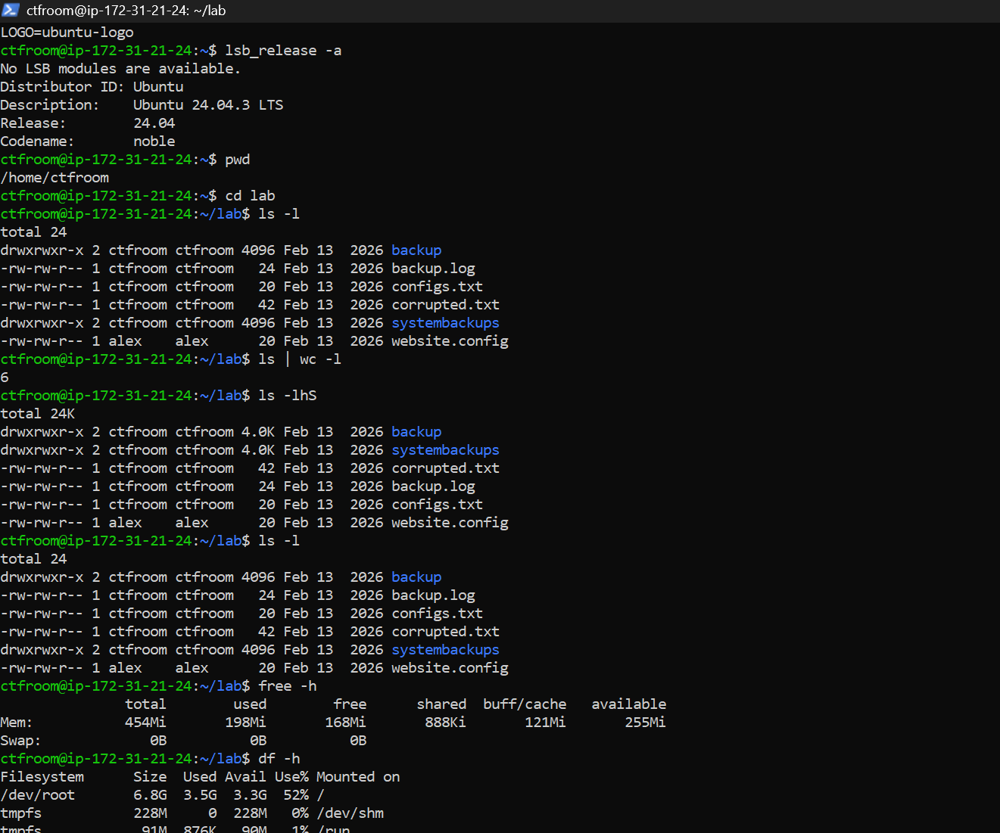
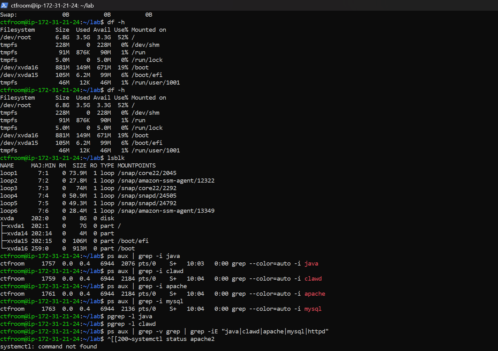
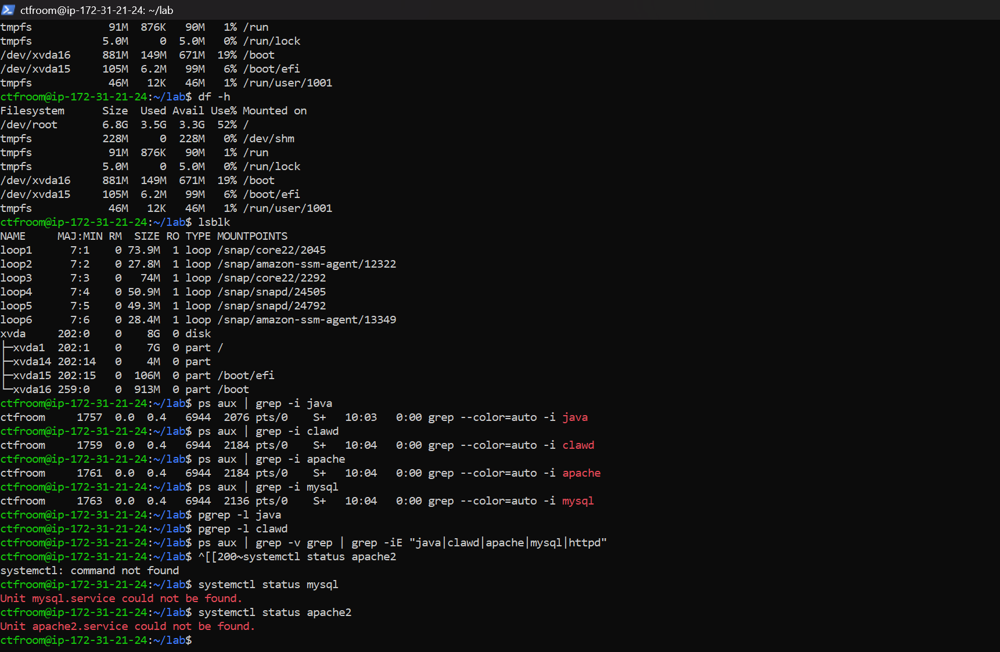
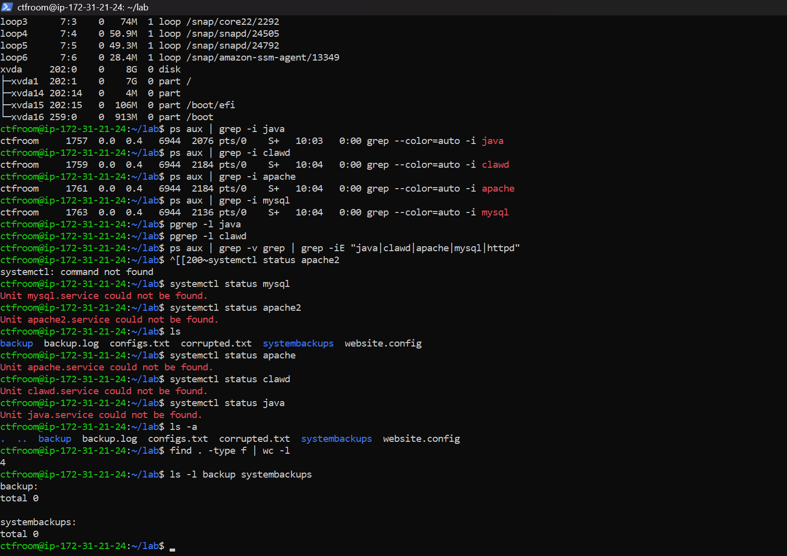
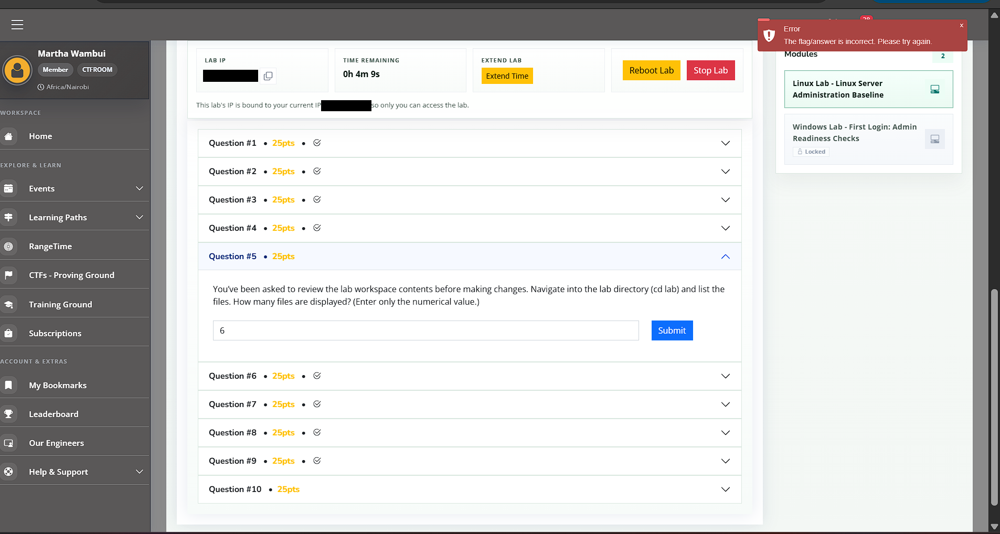
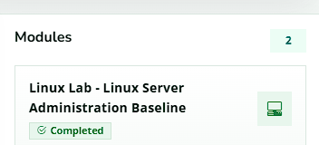

# 🐧 Linux Server Administration Baseline Lab: First-Login System Triage over SSH


This project documents my hands-on work in the **Linux Server Administration Baseline Lab** from the CyberHer Secure Lab series. Playing the role of an on-call system administrator, I logged into a Linux server over SSH and built a clean baseline of it before changing anything: system identity, filesystem context, file ownership, memory and disk capacity, and whether the expected background services were actually running. Every command is explained in plain language so beginners can follow along.

---

## 📖 Project Overview

**Scenario:** Mjengo IT Systems is onboarding a cohort of junior administrators to support a real estate management platform that runs on Linux and Windows servers, with some workloads in the cloud. After a routine change window, users report slow logins, intermittent application errors, and failed scheduled backups. As the on-call SysAdmin, the job is to validate the environment and confirm that access and operations follow good practice.

**What this lab covers:** the first things a competent admin does on a new server: identify the OS and distribution, confirm where you landed, inspect a lab workspace (what exists, what is large, who owns what), check RAM and disk, and verify that expected processes are really running.

**Exercises completed:**

1. Identify the operating system of the server
2. Find the exact distribution release number
3. Find the full distribution description string
4. Confirm the default working directory after login
5. Navigate into the lab directory and review what is displayed
6. Identify the largest item in the lab directory
7. Check file ownership for a specific user
8. Check the server's RAM size
9. Check the server's hard disk size
10. Confirm which expected background processes are not running

> ⚠️ **Ethical note:** All testing was performed exclusively within a private, sandboxed training lab provisioned for this course. No external or unauthorized systems were accessed. Credentials, public IP addresses, and other secrets visible in the original screenshots have been redacted with black boxes and are not recorded anywhere in this repository.

---

## 🧰 Tech Stack

| Tool / Platform | Purpose |
|---|---|
| OpenSSH client (Windows PowerShell) | Secure remote login to the lab server |
| Ubuntu 24.04.3 LTS (AWS-hosted lab instance) | Target Linux server |
| `cat`, `lsb_release` | Identify OS and distribution details |
| `pwd`, `cd`, `ls`, `wc`, `find` | Navigate and inspect the filesystem |
| `free`, `df`, `lsblk` | Memory and disk capacity checks |
| `ps`, `grep`, `pgrep`, `systemctl` | Process and service verification |
| CyberHer Secure Lab dashboard | Starts the lab, shows lab details, and checks answers |

---

## ✨ Features

- ✅ Repeatable first-login baseline workflow for a Linux server
- ✅ Beginner-friendly explanation of every command
- ✅ Cross-checking a result with more than one method (for example `ps` and `systemctl`)
- ✅ Documented mistakes and fixes in a troubleshooting table
- ✅ Redacted, numbered screenshots as evidence for each step
- ✅ Quick-reference command list in [`payloads.md`](payloads.md)

---

## ✅ Prerequisites

- Access to the CyberHer Secure Lab platform and the Linux Server Administration Baseline module
- An SSH client (OpenSSH is built into Windows 10/11 PowerShell, macOS, and Linux terminals)
- The lab IP, username, and password shown on the lab dashboard after the lab starts
- Basic comfort typing commands in a terminal (no prior Linux experience needed)
- Note: the dashboard states that the lab's IP is bound to your current public IP, so connect from the same network you launched the lab from

---

## ⚙️ Installation / Setup

1. Open the **Linux Lab - Linux Server Administration Baseline** module on the platform.
2. Click **Start Lab** and wait up to 3 minutes for the instance to start. Until then, the IP field only shows a `{{IP}}` placeholder.
3. Copy the lab IP and credentials from the **Access Details** table (the password is intentionally not recorded in this repo).
4. Open a terminal. I used Windows PowerShell.
5. Connect with `ssh <username>@<LAB_IP>` and enter the password when asked. Nothing appears on screen while you type a password. That is normal.
6. Confirm the Ubuntu welcome banner appears and you reach a shell prompt.
7. Watch the **Time Remaining** counter on the dashboard and use **Extend Time** if you need longer.



---

## 🚀 Usage Guide

### Part 1: System identity

#### Step 1: Read the OS release file

```bash
cat /etc/os-release
```

`cat` prints a file to the screen. `/etc/os-release` is a standard text file that describes the operating system. Look at the `NAME` and `ID` lines to see which OS you are on.



#### Step 2: Show distribution details

```bash
lsb_release -a
```

This prints the distribution in a tidy form. The `Release:` line is the version number, and the `Description:` line is the full description string. Copy them exactly as shown when documenting a host.



#### Step 3: Confirm where you landed

```bash
pwd
```

`pwd` means "print working directory". It shows the full path of the folder you are in, which for a first login is your home directory.

### Part 2: Workspace review

#### Step 4: Enter the lab folder and list it

```bash
cd lab
ls -l
```

`cd` moves into a folder. `ls -l` lists its contents in long format. In the first column, a leading `-` marks a regular file and a leading `d` marks a directory (folder).

#### Step 5: Count what is displayed

```bash
ls | wc -l
```

`ls` prints the names and `wc -l` counts lines, so together they count the entries. Remember that this counts folders as well as files. See the troubleshooting section for why that matters.

#### Step 6: Find the largest item

```bash
ls -lhS
```

`-S` sorts by size (largest first) and `-h` prints human-readable sizes. Folders can appear at the top because of how their size is reported, so check the first character of each line to separate files from directories before deciding which file is largest.

#### Step 7: Check who owns each file

```bash
ls -l
```

In the long listing, the third column is the **owner** and the fourth is the **group**. Scan the owner column for the user named in the question.

### Part 3: Capacity baseline

#### Step 8: Check memory

```bash
free -h
```

`free` shows RAM and swap. `-h` makes the numbers readable. The `Mem:` row's `total` column is the installed RAM.

#### Step 9: Check disk space

```bash
df -h
lsblk
```

`df -h` shows how full each mounted filesystem is. `lsblk` lists the physical disk and its partitions. The row with TYPE `disk` is the whole drive, while the `part` rows are slices of it. Ignore the `loop` entries, which are small virtual snap packages.



### Part 4: Process and service sanity

#### Step 10: Check whether expected processes are running

```bash
ps aux | grep -i <name>
pgrep -l <name>
ps aux | grep -v grep | grep -iE "<name1>|<name2>|<name3>"
systemctl status <name>
```

`ps aux` lists every running process and `grep` filters the list. **Warning:** `grep` shows up in its own results, so a single line ending in `grep --color=auto ...` does not mean the program is running. `pgrep -l` prints a match only if a real process exists, and the `grep -v grep` version removes the grep line. Finally, `systemctl status` asks the service manager whether a service exists at all. "Could not be found" means it is not installed as a service, which is stronger evidence than "not running".



### Part 5: Re-verify with a second method

```bash
ls -a
find . -type f | wc -l
ls -l backup systembackups
```

`ls -a` also shows hidden files. `find . -type f` counts only regular files, including inside subfolders. The last command looks inside the two subfolders. Using a second method like this is how admins confirm what they think they saw.



---

## 📊 Baseline Findings Summary

| Area | Finding | Evidence |
|---|---|---|
| Operating system | Ubuntu Linux (Debian family), codename "noble" | `02`, `03` |
| Release / description | 24.04 / Ubuntu 24.04.3 LTS | `02`, `03` |
| Kernel / architecture | Linux 6.14.0-1010-aws, x86_64 | `02` |
| Login directory | `/home/ctfroom` | `03` |
| Lab workspace | 6 entries shown by `ls`: 4 regular files and 2 directories, no hidden files | `03`, `08` |
| Backup folders | Both `backup` and `systembackups` are empty | `08` |
| Memory | About 454 MiB RAM total, no swap | `03` |
| Disk | 8 GiB virtual disk; root filesystem 6.8 GiB at 52% used | `04` |
| Expected services | None of the four services named in the question were running, and none were registered as systemd units | `04`, `05`, `08` |
| Patch status (login banner) | Update list more than a week old; 24 extra security updates available only via ESM Apps | `02` |

---

## 📁 Project Structure

```
linux-server-admin-baseline-lab/
├── README.md
├── payloads.md
└── screenshots/
    ├── 01-lab-dashboard-before-start.png               # Lab dashboard before clicking Start Lab (password redacted)
    ├── 02-ssh-login-and-os-release.png                 # SSH login banner and /etc/os-release (IPs redacted)
    ├── 03-distro-release-workspace-ram-disk.png        # lsb_release, pwd, ls variants, free -h, start of df -h
    ├── 04-disk-block-devices-and-process-checks.png    # df -h, lsblk, ps/grep and pgrep checks
    ├── 05-service-checks-systemctl.png                 # Failed pasted command, then systemctl service checks
    ├── 06-question-10-incorrect-attempt.png            # Platform rejecting my first selection (IPs redacted)
    ├── 07-question-5-incorrect-attempt.png             # Platform rejecting my first attempt (IPs redacted)
    ├── 08-recheck-hidden-files-and-empty-folders.png   # ls -a, find -type f, contents of the two folders
    └── 09-module-completed.png                         # Module marked Completed
```

---

## ⚙️ Configuration Options

| Setting | Where | Notes |
|---|---|---|
| Lab IP | Lab dashboard | Appears after **Start Lab**; changes each launch; bound to your current public IP |
| Username / password | Access Details table | Not recorded in this repo |
| SSH port | `ssh` command | Default port used (no `-p` option needed) |
| Lab timer | Lab dashboard (Time Remaining, Extend Time) | Extend before it runs out so your session is not cut off |
| `-h` flag | `ls`, `free`, `df` | Human-readable sizes (KB, MB, GB) |
| `-S` flag | `ls` | Sort by size, largest first |
| `-a` flag | `ls` | Include hidden files |
| `-i` / `-E` flags | `grep` | Ignore case / allow several patterns separated by a pipe character |

---

## 🔧 Troubleshooting

| Issue | Likely Cause | Fix |
|---|---|---|
| IP shows `{{IP}}` and I cannot connect | Lab has not been started or is still booting | Click **Start Lab**, wait up to 3 minutes, refresh the page |
| Nothing appears when typing the password | SSH hides password input | Type or paste it and press Enter |
| `systemctl: command not found` with `^[[200~` at the start of the line | The pasted text carried hidden terminal characters in front of the command | Retype the command by hand (it worked on the next attempt) |
| `ps aux \| grep name` shows one line but the program is not running | `grep` matched its own process | Use `pgrep -l name` or `ps aux \| grep -v grep \| grep -i name` |
| Size-sorted listing shows folders above files | Folders are reported at 4.0K each, larger than tiny files | Check the first character (`-` file, `d` directory) before choosing the largest file |
| File-count question marked incorrect (`07`) | "Files displayed" is ambiguous: `ls` counts folders and files together | Cross-check with `ls -a`, `find . -type f`, and `ls -l` inside each folder to understand exactly what is there |
| Process question marked incorrect (`06`) | "Not running" can mean stopped, or not installed at all | Verify with both `ps`/`pgrep` and `systemctl status`, then re-read the question wording |
| Session may end mid-lab | Lab timer expired | Use **Extend Time** on the dashboard |
| Cannot reach the lab from another network | Dashboard states the lab IP is bound to your current public IP | Connect from the same network used to launch the lab |





---

## 🤝 Contributing

Suggestions and corrections are welcome.

1. Fork this repository
2. Create a branch: `git checkout -b improve-docs`
3. Commit your changes: `git commit -m "Describe your change"`
4. Push the branch and open a pull request

Found an error or an unclear explanation? Please open an issue.

---

## 🛠️ Remediation / Defensive Takeaways

**Baselining and documentation**
- Record OS, release, kernel, memory, and disk for every host so changes and drift are easy to spot.
- Re-verify important findings with a second method before reporting them.

**Service monitoring**
- Monitor that critical services are running, and alert when one disappears, rather than waiting for users to report it.
- Distinguish "stopped" from "not installed" (`systemctl status`) when triaging an outage.

**Backups**
- Both backup folders in the lab were empty, which fits the scenario of failed scheduled backups. Verify backups by checking their contents and test restores regularly.

**Least privilege and ownership**
- Review file ownership and permissions in shared workspaces so each file is owned by the right user, and give users only the access they need.

**Capacity**
- Small servers with no swap leave little room for spikes. Track memory and disk use over time and plan capacity before problems start.

**Secure remote access**
- Prefer SSH keys over passwords, restrict which source IPs can connect, and turn on multi-factor authentication where available.
- Never share or reuse passwords in plain text outside a training lab.

**Patching**
- The login banner showed an old update list and extra security updates available. Refresh package lists regularly and apply security patches on a schedule.

---

## 📄 License

Released under the **MIT License**. You are free to reference this project with attribution.

---

## 📬 Contact

- **Name:** Martha Wambui
- **Email:** marthamichellewambui@gmail.com
- **LinkedIn:** [martha-wambui](https://www.linkedin.com/in/martha-wambui-4293873b5/)
- **GitHub:** [marz-w](https://github.com/marz-w)

---

*This project was completed in a private training environment, and no unauthorized systems were accessed.*
